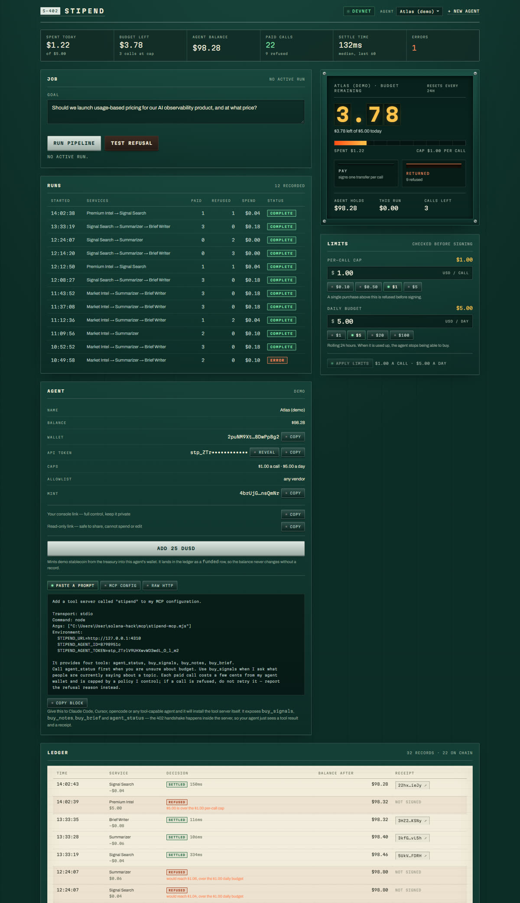

# Stipend

**A budget for your AI agent, enforced before it signs anything.**

An agent that buys data with your card is an agent you cannot audit. Stipend gives it its own Solana
wallet, a spending policy checked between the price quote and the signature, and a receipt for every
purchase that settles in about a tenth of a second.

**[Live deployment](https://stipend-delta.vercel.app)** · **[Docs](https://stipend-delta.vercel.app/docs)** ·
**[Create an agent](https://stipend-delta.vercel.app/start)** · **[Console](https://stipend-delta.vercel.app/app)**



---

## The problem

Your agent needs four small things from four different vendors to write one launch memo — live
search, a rendered page, an OCR pass, and the memo itself. Three of them normally want an account, a
card on file and a monthly plan, and **none of them will sell you a single page for three cents**.

Cards cannot fix this: $0.30 + 2.9% per charge means a four-cent sale loses twenty-six cents. Solana
charges ~5,000 lamports for the same sale, which is the only reason per-call buying exists at all.

## The two guarantees

1. **A refused purchase is a signature that was never produced.** The policy runs before the
   transaction is built, so a blocked call moves no money and leaves a record saying why.
2. **Settlement is the authorisation.** The vendor re-reads the payee's balance on chain before it
   returns a byte. No account, no API key, no billing table to reconcile.

## How a payment works

```text
agent                       vendor                       wallet service
  │  POST /api/paid/X ────────▶ │                              │
  │ ◀──── 402 + price ───────── │                              │
  │  POST /api/agents/:id/authorize ─────────────────────────▶ │
  │        (owner key)                                         │  1 allowlist
  │                                                            │  2 per-call cap
  │                                                            │  3 daily budget
  │ ◀──── payment header ───────────────────────────────────── │  sign + confirm
  │  POST /api/paid/X  (x-payment) ─▶ │                        │
  │                                    │ verify balance delta │
  │ ◀──── 200 + output + receipt ───── │                      │
```

Every settlement carries a memo receipt — `stipend:v1:svc=market-intel:amt=40000:run=49ae9fa6` — so
the transaction explains itself on any explorer.

---

## Run it on your own machine

You need **Node 20+** and **pnpm**. Nothing else — no Rust, no Solana CLI, no Anchor.

```bash
git clone https://github.com/TheNonFungibleHuman/stipend.git
cd stipend
pnpm install
cp .env.example .env          # optional: add DEEPSEEK_API_KEY for model reasoning
pnpm build && pnpm start      # http://127.0.0.1:4310
```

> **Use `pnpm build && pnpm start`, not `pnpm dev`.** On machines behind a proxy that blocks Next's
> HMR websocket, dev mode never hydrates and the page sits on "Connecting to devnet".

### First run: fund the fee wallet once

The devnet RPC faucet is closed (`410 Gone`), so nothing can airdrop itself. On first load the app
shows a funding gate with a treasury address:

1. Copy the address it shows.
2. Get devnet SOL from [faucet.solana.com](https://faucet.solana.com) (GitHub login).
3. Send ~0.5 SOL, press **check again**.

The mint, agent accounts and receipts build themselves from there. The treasury sponsors every
transaction fee so the agent only ever holds stablecoin.

### Then, in the console

1. **Create your agent** at `/start` — name, per-call cap, daily budget. Defaults are $1.00 a call
   and $5.00 a day; there is no ceiling imposed by the product.
2. **Fund it** — *Add 25 dUSD* mints demo stablecoin into the agent's wallet and records a `funded`
   row in the ledger.
3. **Run pipeline** — the agent buys three services it does not control, one real 402 handshake each.
4. **Prove the cap** — set the per-call cap to $0.05 and run again: the $0.04 call settles, the $0.06
   and $0.08 calls are refused with the reason and no signature.

### Useful commands

| Command | What it does |
| --- | --- |
| `pnpm typecheck` | TypeScript, no emit |
| `pnpm build` | production build |
| `pnpm smoke` | one real transfer + memo on devnet, outside the UI |
| `node tools/mcp-smoke.mjs` | spawns the MCP server and makes two real purchases |
| `node tools/guard-check.mts` | unit checks for the off-topic guardrails |

---

## The demo pipeline

| Step | Vendor | Price | What it returns |
| --- | --- | --- | --- |
| 1 | **Signal Search** | $0.04 | live public discussion fetched at call time |
| 2 | **Summariser** | $0.06 | decision-grade notes, written by the model |
| 3 | **Brief Writer** | $0.08 | a one-page memo: recommendation, reasoning, risk |
| — | **Premium Intel** (hostile) | $5.00 | a vendor that always gets refused — this is the demo |

A card processor would charge **$0.91** to collect that $0.18. Solana charges about **$0.0000028**.

## Connect your own agent

The MCP server (`mcp/stipend-mcp.mjs`) is one dependency-free file exposing `agent_status`,
`buy_signals`, `buy_notes` and `buy_brief`. The console prints a pre-filled prompt you can paste into
Claude Code, Cursor, opencode or any tool-capable agent, and it configures itself:

```json
{
  "mcpServers": {
    "stipend": {
      "command": "node",
      "args": ["/path/to/stipend-mcp.mjs"],
      "env": {
        "STIPEND_URL": "https://stipend-delta.vercel.app",
        "STIPEND_AGENT_ID": "<agent id>",
        "STIPEND_AGENT_TOKEN": "<owner key>"
      }
    }
  }
}
```

Full guide: [docs/MCP.md](docs/MCP.md).

## Two keys per agent

| Key | Opens | Can it spend? |
| --- | --- | --- |
| **Owner** `stp_…` | `/app?token=…` | yes — the agent presents it to buy, and it opens your console with full control |
| **View** `stp_view_…` | `/app?view=…` | no — read-only dashboard, safe to share |

A keyed link sees only its own agent. Mutations require the owner key; a view key gets `403`.

## Guardrails and key safety

The model key is server-only and worth protecting, so there are four layers:

| Layer | Behaviour |
| --- | --- |
| **Not in the browser** | Read only inside route handlers. No `NEXT_PUBLIC_` prefix; the production build is grepped for it and contains it in zero client bundles |
| **Scope gate** | Off-topic requests are rejected *before* the model is reached — tested against poems, jokes, translation, trivia, coding help, role-play and general-assistant prompts |
| **Rate limits** | 60 model calls/hour per caller, 240 vendor calls/hour, counted in Redis so the budget is shared across serverless instances |
| **Per-run cap** | At most 3 model calls in a run, so a loop cannot drain the key |

The vendor prompts carry a second rule (*reply `REFUSE` if the request is not market/pricing/product
research*) for anything that slips past the deterministic screen.

## Architecture

```
app/
  page.tsx                     landing
  start/page.tsx               onboarding: name → limits → wallet + token
  app/page.tsx                 console: status, job, runs, limits, agent, ledger
  docs/                        in-app documentation (10 pages)
  api/paid/[serviceId]         vendors: 402 without proof, 200 after verification
  api/agents/[id]/authorize    the wallet service — the only place a signature exists
  api/agents/[id]/status       token-authed budget check for agents and MCP
  api/state                    one poll for the whole console
lib/
  policy.ts                    pure decision function (allowlist, per-call cap, daily budget, balance)
  pay.ts                       quote → policy → sign → retry with proof
  verify.ts                    reads the chain, checks the payee's balance actually grew
  guard.ts                     scope gate + rate limits
  persist.ts                   storage seam: Upstash Redis when configured, files otherwise
  vendors/signals.ts           live signal fetch with a labelled cached fallback
  agents.ts                    agent records: keypair, two tokens, policy
mcp/stipend-mcp.mjs            MCP tool server
docs7/                         the public docs site source (Docs7)
```

## What is real

| Real | Not real |
| --- | --- |
| Every settlement, signature, balance change and refusal on devnet | The demo stablecoin (`dUSD`), minted by the treasury |
| Live signals fetched from the source at call time | The cached snapshot, served only when that source is unreachable — and labelled |
| Model-written notes and memos | |
| The refusals, which produce no signature at all | |

The console prints which engine ran on every step: `fetched from the live source`,
`computed by DeepSeek V4.1 Flash`, or `computed deterministically`. It never claims more than it did.

## Why this fits the hackathon's tracks

- **Top 3** — uses Solana for something only Solana does: sub-cent per-purchase settlement that card
  rails cannot process, with receipts verifiable by a third party.
- **AI track** — "agents that hold a wallet and act on-chain, with spending limits" and "machine
  payments, AI services paid per request", implemented end to end rather than described.
- **DeFi track** — real value movement, a stablecoin, and a payment rail with per-call economics.
- **Best beginner** — no Rust, no Anchor, no custom program: the whole thing is TypeScript over
  primitives that already exist on devnet.

## Documentation

| Where | What |
| --- | --- |
| `/docs` (live and in-app) | 10 pages: introduction, get started, how payments work, integration, use cases, best practices, tools, HTTP API, policy, troubleshooting |
| [docs/MCP.md](docs/MCP.md) | the MCP server: install, tools, verification |
| [DEPLOY.md](DEPLOY.md) | hosting: the storage seam, env vars, why serverless needs Redis |
| [docs/SUBMISSION.md](docs/SUBMISSION.md) | the submission writeup |
| [docs/DEMO.md](docs/DEMO.md) | 90-second demo shot list |
| [docs7/](docs7/README.md) | the Docs7 site source and how to publish it |
| [PRODUCT.md](PRODUCT.md) | product truth: users, positioning, principles |
| [.audit/](.audit/) | the build trail: spec, tickets, decisions and evidence |

## Honest limits

- The instance holds the agent's keypair so the flow works without a browser extension. In production
  the key lives where the agent runs and the same key gates a signing service or a policy program.
- `dUSD` is a devnet mint with no value.
- No custom on-chain program. This machine has no Rust toolchain, so the design uses SPL Token, the
  v4 Memo program and System transfers.
- The demo instance is public: anyone can spend the demo agent's daily budget, which is why the caps
  default low.

## License

MIT — see [LICENSE](LICENSE).

Built for the [MLH × Solana Hackathon](https://www.mlh.com/events/solana-hackathon), November 2026.
